i didn't set out to become a brand strategist. i set out to build things.

so i built. a coffee brand called **el mejor**, which i scaled and sold. [**happy beginnings**](http://happybeginnings.in), india's first digital wedding invite service. a daily newsletter called [**the stupidpreneur**](https://stupidpreneur.beehiiv.com), which i also sold. **two paise club**, to get people reading non-fiction so they could upskill.

somewhere in there i noticed a pattern. the product rarely decided who won. the brand did. two things could be equally good, and people would still pick one, remember it, and come back to it. i wanted to know why.

i chased that question at [**guvi hcl**](https://www.guvi.in), where i led brand for a year. one of the youngest heads of brand in india at the time, and we set a guinness record while i was there. guvi hcl is not a startup, so every brand call had to survive committees and still land with real people. that's where i learned that a brand that only works in a deck isn't a brand. it's a proposal.

now i chase it fractionally, a few companies at a time. positioning, brand decisions, the calls that decide whether your marketing spend compounds or bleeds. seven years and 150+ companies in, i put what i know into [**brandeey**](http://brandeey.com), so you don't have to hire me to use it.

then ai showed up and started sanding every founder's voice down to the same texture. people with a real voice were shipping posts that read like a press release written by a committee. so i built [**ellora**](https://getellora.com). it lives inside chatgpt, claude and the other apps your team already writes in. it learns how your brand sounds, then fixes each draft before anyone has to. this readme went through it too.

right now i'm also building [**sayabout.us**](http://sayabout.us) with my co-founders, a testimonial tool. it's the same question again, only this time your customers answer it.

i've given 100+ talks, and i think out loud on [**x**](http://x.com/istupidpreneur) more than i probably should.

so if you built something good and people still pick the other one, [come talk to me](http://x.com/istupidpreneur).

